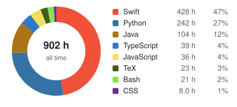
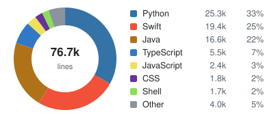

### [whoami](https://en.wikipedia.org/wiki/Whoami)
```sh
Hello! I'm Rubesh

Software engineer: iOS (Swift, SwiftUI, UIKit), backend and robotics.
B.Eng Mechanical Engineering (Robotics) with a Second Major in Computer Science, NUS, 2026.
Robotics && software engineering && systems thinking. Based in Singapore.
```

### tech stack
<!-- tech stack: generated by .github/scripts/techstack.py -->
**languages**&emsp;&ensp;&nbsp;&nbsp;[Swift](https://github.com/sp4ce-cowboy/SpacePeggle/blob/main/ARCHITECTURE.md#6-the-physics-engine) · [Python](https://github.com/sp4ce-cowboy/makaber/blob/main/ARCHITECTURE.md#5-the-use-case-pipeline) · [Java](https://github.com/sp4ce-cowboy/discrete-event-simulator/blob/013aa28a67f6bd67c64cfcd61fdc23a33f8f4f3a/99_FinalProject/Simulator.java#L142-L184) · [TypeScript](https://github.com/sp4ce-cowboy/PeerPrep/blob/3b54cadfac2e6dd515097c149c4705e9c1cc6734/peerprep/frontend/src/api/matchingApi.ts#L138-L195) · [JavaScript](https://github.com/sp4ce-cowboy/nus-wayang-kulit/blob/7be6ad25921de924c9ddddfc21979f39225b28c5/src/common/InverseKinematics.js) · [C](https://github.com/sp4ce-cowboy/computer-organisation/blob/main/mips-datapath-simulator/mips.c) · [C++](https://github.com/sp4ce-cowboy/robotic-system-design/blob/54daac50e1fe1d8af0c7f0010ea4dc71b6893996/src/ee3305_nav/src/planner.cpp#L175-L260) · [MIPS assembly](https://github.com/sp4ce-cowboy/computer-organisation#mips-assembly-and-c-labs) · Obj-C<br>
**apple**&emsp;&emsp;&emsp;&ensp;&nbsp;&#8197;&thinsp;&thinsp;&#8202;&#8202;[SwiftUI](https://github.com/sp4ce-cowboy/SpacePeggle/blob/main/ARCHITECTURE.md#3-app-structure) · [UIKit](https://github.com/sp4ce-cowboy/TowerForge/blob/main/ARCHITECTURE.md#3-top-level-design) · [SpriteKit](https://github.com/sp4ce-cowboy/TowerForge/blob/main/ARCHITECTURE.md#9-rendering) · [XCTest](https://github.com/sp4ce-cowboy/SpacePeggle/blob/main/ARCHITECTURE.md#11-testing) · [SwiftLint](https://github.com/sp4ce-cowboy/SpacePeggle/blob/main/SpacePeggle/.swiftlint.yml) · [Xcode](https://github.com/sp4ce-cowboy/TowerForge/blob/main/.github/workflows/ios.yml) · [App Store](https://apps.apple.com/app/id6833552919)<br>


**frontend**&emsp;&emsp;&nbsp;&nbsp;&#8197;&#8202;[React](https://github.com/sp4ce-cowboy/PeerPrep/blob/3b54cadfac2e6dd515097c149c4705e9c1cc6734/peerprep/frontend/src/views/MatchingServiceViews/MatchingServiceMainView.tsx#L5-L91) · [React Native](https://github.com/sp4ce-cowboy/wanderminds/blob/fab9d975a66c29973dc4231b0daf19e0303a0051/wanderMinds/app/screens/ExplorerScreen.tsx#L173-L224) · [Expo](https://github.com/sp4ce-cowboy/wanderminds/blob/fab9d975a66c29973dc4231b0daf19e0303a0051/wanderMinds/app.config.js) · [Three.js](https://github.com/sp4ce-cowboy/nus-wayang-kulit/blob/7be6ad25921de924c9ddddfc21979f39225b28c5/src/main.js#L101-L154) · [Vite](https://github.com/sp4ce-cowboy/nus-wayang-kulit/blob/7be6ad25921de924c9ddddfc21979f39225b28c5/src/package.json#L6-L13) · [JavaFX](https://github.com/sp4ce-cowboy/tp/blob/52513265da923537713fc58a048d7f7741ee3fc6/src/main/java/unicash/ui/StatusBarFooter.java#L40-L70) · [HTML](https://github.com/sp4ce-cowboy/sp4ce-cowboy.github.io/blob/main/index.html) · [CSS](https://github.com/sp4ce-cowboy/PeerPrep/blob/3b54cadfac2e6dd515097c149c4705e9c1cc6734/peerprep/frontend/src/styles/App.css)<br>
**backend**&emsp;&emsp;&ensp;&#8197;&thinsp;[FastAPI](https://github.com/sp4ce-cowboy/makaber/blob/main/ARCHITECTURE.md#4-layers) · [Pydantic](https://github.com/sp4ce-cowboy/makaber/blob/main/ARCHITECTURE.md#3-domain-model) · [Uvicorn](https://github.com/sp4ce-cowboy/makaber/blob/main/ARCHITECTURE.md#2-system-context) · [Flask](https://github.com/sp4ce-cowboy/makaber/blob/main/ARCHITECTURE.md#12-staff-tooling) · [Node.js](https://github.com/sp4ce-cowboy/PeerPrep/blob/3b54cadfac2e6dd515097c149c4705e9c1cc6734/peerprep/backend/question-service/src/server.ts#L38-L44) · [Express](https://github.com/sp4ce-cowboy/PeerPrep/blob/3b54cadfac2e6dd515097c149c4705e9c1cc6734/peerprep/backend/question-service/src/server.ts#L38-L44) · [Docker](https://github.com/sp4ce-cowboy/PeerPrep/blob/3b54cadfac2e6dd515097c149c4705e9c1cc6734/peerprep/backend/docker-compose.yaml#L38-L41)<br>
**database**&emsp;&emsp;&nbsp;&#8202;&#8202;&#8202;&#8202;&#8202;[SQL](https://github.com/sp4ce-cowboy/course-expiry/blob/main/ARCHITECTURE.md#4-data-model) · [PostgreSQL](https://github.com/sp4ce-cowboy/course-expiry/blob/main/ARCHITECTURE.md#3-system-context) · [SQLite](https://github.com/sp4ce-cowboy/course-expiry/blob/main/ARCHITECTURE.md#4-data-model) · [MongoDB](https://github.com/sp4ce-cowboy/PeerPrep/blob/3b54cadfac2e6dd515097c149c4705e9c1cc6734/peerprep/backend/question-service/src/controllers/questionController.ts#L123-L135) · [Redis](https://github.com/sp4ce-cowboy/PeerPrep/blob/main/ARCHITECTURE.md#5-matching) · [Firebase](https://github.com/sp4ce-cowboy/TowerForge/blob/main/ARCHITECTURE.md#7-storageapi-offline-first-progress) · [pandas](https://github.com/sp4ce-cowboy/dashBoard/blob/36c240ad9e0514e75006f436768333133055316d/main.py#L325-L349)<br>

**testing**&emsp;&emsp;&emsp;&nbsp;&#8197;&thinsp;[JUnit5](https://github.com/sp4ce-cowboy/tp/blob/52513265da923537713fc58a048d7f7741ee3fc6/src/test/java/unicash/testutil/UserInputBuilder.java) · [JaCoCo](https://github.com/sp4ce-cowboy/tp/blob/52513265da923537713fc58a048d7f7741ee3fc6/build.gradle#L6) · [Codecov](https://github.com/sp4ce-cowboy/tp/blob/52513265da923537713fc58a048d7f7741ee3fc6/.github/workflows/gradle.yml#L43) · [Checkstyle](https://github.com/sp4ce-cowboy/tp/blob/52513265da923537713fc58a048d7f7741ee3fc6/build.gradle#L19-L21)<br>
**tools**&emsp;&emsp;&emsp;&emsp;&nbsp;&thinsp;&thinsp;&#8202;&#8202;[Git](https://github.com/sp4ce-cowboy/tp) · [GitHub Actions](https://github.com/sp4ce-cowboy/TowerForge/blob/main/.github/workflows/ios.yml) · [Bash](https://github.com/sp4ce-cowboy/artificial-consciousness/blob/38f65a2b6f05986697fcfbb1662eaf9ca8e649d6/Experimental%20Variants/bv2.0.sh#L183-L345) · [Gradle](https://github.com/sp4ce-cowboy/ip/blob/master/build.gradle) · [IntelliJ IDEA](https://wakatime.com/@space_cowboy) · [Vim](https://github.com/sp4ce-cowboy/discrete-event-simulator#readme) · [LaTeX](https://github.com/sp4ce-cowboy/artificial-consciousness/blob/main/Written%20Articles/Proposal.tex) · [PlantUML](https://github.com/sp4ce-cowboy/makaber/blob/main/ARCHITECTURE.md#12-staff-tooling) · [Javadoc](https://github.com/sp4ce-cowboy/discrete-event-simulator/tree/main/99_FinalProject/javadocs)

**ai & vision**&emsp;&ensp;&nbsp;&nbsp;&#8202;&#8202;[OpenCV](https://github.com/sp4ce-cowboy/AddamNet/blob/7c47efae85a2158621a294750ad775ef63fd990b/slam/visual_slam.py#L199-L243) · [YOLO](https://github.com/sp4ce-cowboy/AddamNet/blob/main/ARCHITECTURE.md#4-defect-detection-yolov8) · [NumPy](https://github.com/sp4ce-cowboy/AddamNet/blob/7c47efae85a2158621a294750ad775ef63fd990b/slam/reconstruct_viewer.py#L69-L195) · [OpenAI](https://github.com/sp4ce-cowboy/natural-query-language/blob/626a70c4c86d0381546c51ad30493e2836447402/src/pgconnection.py#L267-L328) · [Hailo-8](https://github.com/sp4ce-cowboy/smart-digital-junction/blob/47e7df92e91134a99e2a8a3d308786f91635297a/scripts/modelcompiler.py)<br>
**robotics**&emsp;&emsp;&nbsp;&nbsp;&#8197;&thinsp;&thinsp;[ROS 2](https://github.com/sp4ce-cowboy/robotic-system-design/blob/54daac50e1fe1d8af0c7f0010ea4dc71b6893996/src/ee3305_nav/src/controller.cpp#L139-L300) · [Gazebo](https://github.com/sp4ce-cowboy/robotic-system-design/blob/main/ARCHITECTURE.md#2-system) · [Arduino](https://github.com/sp4ce-cowboy/AddamNet/blob/7c47efae85a2158621a294750ad775ef63fd990b/arduino/sensor_suite.ino) · [Raspberry Pi](https://github.com/sp4ce-cowboy/AddamNet/blob/main/ARCHITECTURE.md#2-system-architecture)<br>
**engineering**&ensp;&nbsp;&nbsp;&thinsp;&thinsp;[Fusion 360](https://github.com/sp4ce-cowboy/autonomous-robot#design) · [SolidWorks](https://github.com/sp4ce-cowboy/solidworks-cad#tutorial-3-roller-bracket) · MATLAB · [Logisim](https://github.com/sp4ce-cowboy/computer-organisation#circuits-in-logisim) · [Stella](https://github.com/sp4ce-cowboy/housing-system-dynamics/tree/main/models)<br>
<!-- end tech stack -->

### some stats
<a href="https://wakatime.com/@space_cowboy"></a>
<a href="https://wakatime.com/@space_cowboy"></a>
<a href="https://wakatime.com/@space_cowboy"></a>
<a href="https://wakatime.com/@space_cowboy"></a>

<a href="https://wakatime.com/@space_cowboy"><picture><source media="(prefers-color-scheme: dark)" srcset="https://raw.githubusercontent.com/sp4ce-cowboy/sp4ce-cowboy/output/languages-dark.svg"></picture></a>
<a href="https://github.com/sp4ce-cowboy?tab=repositories&q=topic%3Aportfolio"><picture><source media="(prefers-color-scheme: dark)" srcset="https://raw.githubusercontent.com/sp4ce-cowboy/sp4ce-cowboy/output/loc-dark.svg"></picture></a>

<a href="https://github.com/sp4ce-cowboy"><picture><source media="(prefers-color-scheme: dark)" srcset="https://raw.githubusercontent.com/sp4ce-cowboy/sp4ce-cowboy/output/github-stats-dark.svg?v=3"></picture></a>
<a href="https://github.com/sp4ce-cowboy"><picture><source media="(prefers-color-scheme: dark)" srcset="https://streak-stats.demolab.com?user=sp4ce-cowboy&hide_border=true&card_height=220&theme=github-dark-blue"></picture></a>
