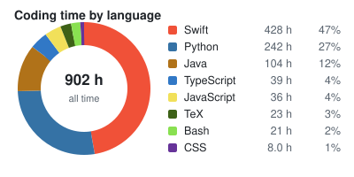
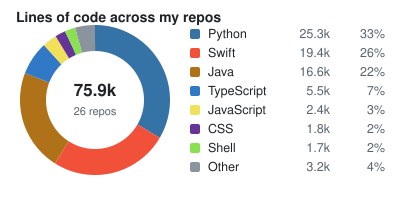
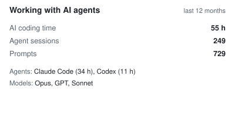

### [whoami](https://en.wikipedia.org/wiki/Whoami)
```sh
Hello! I'm Rubesh

Software engineer: iOS (Swift, SwiftUI, UIKit), backend and robotics.
B.Eng Mechanical Engineering (Robotics) with a Second Major in Computer Science, NUS, 2026.
Robotics && software engineering && systems thinking. Based in Singapore.
```
[rubesh.dev](https://rubesh.dev) · [LinkedIn](https://www.linkedin.com/in/rubesh-suresh/) · [Comet Drop on the App Store](https://apps.apple.com/app/id6833552919) · [project pages](https://github.com/sp4ce-cowboy?tab=repositories&q=topic%3Aportfolio)

### tech stack
<sub>Each badge opens the code or write-up where I used it.</sub>

<p>
<picture><source media="(prefers-color-scheme: dark)" srcset="https://img.shields.io/badge/Languages-21262d?style=for-the-badge"></picture><br/>
<a href="https://github.com/sp4ce-cowboy/SpacePeggle/blob/main/ARCHITECTURE.md#6-the-physics-engine"><picture><source media="(prefers-color-scheme: dark)" srcset="https://img.shields.io/badge/Swift-black?logo=swift&logoColor=F05138"></picture></a>
<a href="https://github.com/sp4ce-cowboy/makaber/blob/main/ARCHITECTURE.md#5-the-use-case-pipeline"><picture><source media="(prefers-color-scheme: dark)" srcset="https://img.shields.io/badge/Python-black?logo=python&logoColor=3776AB"></picture></a>
<a href="https://github.com/sp4ce-cowboy/discrete-event-simulator/blob/013aa28a67f6bd67c64cfcd61fdc23a33f8f4f3a/99_FinalProject/Simulator.java#L142-L184"><picture><source media="(prefers-color-scheme: dark)" srcset="https://img.shields.io/badge/Java-black?logo=openjdk&logoColor=ED8B00"></picture></a>
<a href="https://github.com/sp4ce-cowboy/PeerPrep/blob/3b54cadfac2e6dd515097c149c4705e9c1cc6734/peerprep/frontend/src/api/matchingApi.ts#L138-L195"><picture><source media="(prefers-color-scheme: dark)" srcset="https://img.shields.io/badge/TypeScript-black?logo=typescript&logoColor=3178C6"></picture></a>
<a href="https://github.com/sp4ce-cowboy/nus-wayang-kulit/blob/7be6ad25921de924c9ddddfc21979f39225b28c5/src/common/InverseKinematics.js"><picture><source media="(prefers-color-scheme: dark)" srcset="https://img.shields.io/badge/JavaScript-black?logo=javascript&logoColor=F7DF1E"></picture></a>
<a href="https://github.com/sp4ce-cowboy/robotic-system-design/blob/54daac50e1fe1d8af0c7f0010ea4dc71b6893996/src/ee3305_nav/src/planner.cpp#L175-L260"><picture><source media="(prefers-color-scheme: dark)" srcset="https://img.shields.io/badge/C%2B%2B-black?logo=cplusplus&logoColor=00599C"></picture></a>
<picture><source media="(prefers-color-scheme: dark)" srcset="https://img.shields.io/badge/C-black?logo=c&logoColor=A8B9CC"></picture>
<picture><source media="(prefers-color-scheme: dark)" srcset="https://img.shields.io/badge/Obj--C-black?logo=apple&logoColor=white"></picture>
<a href="https://github.com/sp4ce-cowboy/artificial-consciousness/blob/38f65a2b6f05986697fcfbb1662eaf9ca8e649d6/Experimental%20Variants/bv2.0.sh#L183-L345"><picture><source media="(prefers-color-scheme: dark)" srcset="https://img.shields.io/badge/Bash-black?logo=gnubash&logoColor=4EAA25"></picture></a>
<a href="https://github.com/sp4ce-cowboy/course-expiry/blob/main/ARCHITECTURE.md#4-data-model"><picture><source media="(prefers-color-scheme: dark)" srcset="https://img.shields.io/badge/SQL-black?logo=sqlite&logoColor=003B57"></picture></a>
<a href="https://github.com/sp4ce-cowboy/sp4ce-cowboy.github.io/blob/main/index.html"><picture><source media="(prefers-color-scheme: dark)" srcset="https://img.shields.io/badge/HTML-black?logo=html5&logoColor=E34F26"></picture></a>
<a href="https://github.com/sp4ce-cowboy/PeerPrep/blob/3b54cadfac2e6dd515097c149c4705e9c1cc6734/peerprep/frontend/src/styles/App.css"><picture><source media="(prefers-color-scheme: dark)" srcset="https://img.shields.io/badge/CSS-black?logo=css3&logoColor=1572B6"></picture></a>
</p>

<p>
<picture><source media="(prefers-color-scheme: dark)" srcset="https://img.shields.io/badge/Apple-21262d?style=for-the-badge"></picture><br/>
<a href="https://github.com/sp4ce-cowboy/SpacePeggle/blob/main/ARCHITECTURE.md#3-app-structure"><picture><source media="(prefers-color-scheme: dark)" srcset="https://img.shields.io/badge/SwiftUI-black?logo=swift&logoColor=0D96F6"></picture></a>
<a href="https://github.com/sp4ce-cowboy/TowerForge/blob/main/ARCHITECTURE.md#3-top-level-design"><picture><source media="(prefers-color-scheme: dark)" srcset="https://img.shields.io/badge/UIKit-black?logo=apple&logoColor=2396F3"></picture></a>
<a href="https://github.com/sp4ce-cowboy/TowerForge/blob/main/ARCHITECTURE.md#9-rendering"><picture><source media="(prefers-color-scheme: dark)" srcset="https://img.shields.io/badge/SpriteKit-black?logo=apple&logoColor=white"></picture></a>
<a href="https://github.com/sp4ce-cowboy/SpacePeggle/blob/main/ARCHITECTURE.md#11-testing"><picture><source media="(prefers-color-scheme: dark)" srcset="https://img.shields.io/badge/XCTest-black?logo=xcode&logoColor=147EFB"></picture></a>
<a href="https://github.com/sp4ce-cowboy/TowerForge/blob/main/.github/workflows/ios.yml"><picture><source media="(prefers-color-scheme: dark)" srcset="https://img.shields.io/badge/Xcode-black?logo=xcode&logoColor=147EFB"></picture></a>
<a href="https://apps.apple.com/app/id6833552919"><picture><source media="(prefers-color-scheme: dark)" srcset="https://img.shields.io/badge/App%20Store-black?logo=appstore&logoColor=0D96F6"></picture></a>
</p>

<p>
<picture><source media="(prefers-color-scheme: dark)" srcset="https://img.shields.io/badge/Backend-21262d?style=for-the-badge"></picture><br/>
<a href="https://github.com/sp4ce-cowboy/makaber/blob/main/ARCHITECTURE.md#4-layers"><picture><source media="(prefers-color-scheme: dark)" srcset="https://img.shields.io/badge/FastAPI-black?logo=fastapi&logoColor=009688"></picture></a>
<a href="https://github.com/sp4ce-cowboy/makaber/blob/main/ARCHITECTURE.md#3-domain-model"><picture><source media="(prefers-color-scheme: dark)" srcset="https://img.shields.io/badge/Pydantic-black?logo=pydantic&logoColor=E92063"></picture></a>
<a href="https://github.com/sp4ce-cowboy/makaber/blob/main/ARCHITECTURE.md#12-staff-tooling"><picture><source media="(prefers-color-scheme: dark)" srcset="https://img.shields.io/badge/Flask-black?logo=flask&logoColor=white"></picture></a>
<a href="https://github.com/sp4ce-cowboy/PeerPrep/blob/3b54cadfac2e6dd515097c149c4705e9c1cc6734/peerprep/backend/question-service/src/server.ts#L38-L44"><picture><source media="(prefers-color-scheme: dark)" srcset="https://img.shields.io/badge/Node.js-black?logo=nodedotjs&logoColor=5FA04E"></picture></a>
<a href="https://github.com/sp4ce-cowboy/PeerPrep/blob/3b54cadfac2e6dd515097c149c4705e9c1cc6734/peerprep/backend/question-service/src/server.ts#L38-L44"><picture><source media="(prefers-color-scheme: dark)" srcset="https://img.shields.io/badge/Express-black?logo=express&logoColor=white"></picture></a>
<a href="https://github.com/sp4ce-cowboy/TowerForge/blob/main/ARCHITECTURE.md#7-storageapi-offline-first-progress"><picture><source media="(prefers-color-scheme: dark)" srcset="https://img.shields.io/badge/Firebase-black?logo=firebase&logoColor=FFCA28"></picture></a>
<a href="https://github.com/sp4ce-cowboy/PeerPrep/blob/3b54cadfac2e6dd515097c149c4705e9c1cc6734/peerprep/backend/question-service/src/controllers/questionController.ts#L123-L135"><picture><source media="(prefers-color-scheme: dark)" srcset="https://img.shields.io/badge/MongoDB-black?logo=mongodb&logoColor=47A248"></picture></a>
<a href="https://github.com/sp4ce-cowboy/PeerPrep/blob/main/ARCHITECTURE.md#5-matching"><picture><source media="(prefers-color-scheme: dark)" srcset="https://img.shields.io/badge/Redis-black?logo=redis&logoColor=DC382D"></picture></a>
<a href="https://github.com/sp4ce-cowboy/course-expiry/blob/main/ARCHITECTURE.md#4-data-model"><picture><source media="(prefers-color-scheme: dark)" srcset="https://img.shields.io/badge/SQLite-black?logo=sqlite&logoColor=4A90D9"></picture></a>
<a href="https://github.com/sp4ce-cowboy/course-expiry/blob/main/ARCHITECTURE.md#3-system-context"><picture><source media="(prefers-color-scheme: dark)" srcset="https://img.shields.io/badge/PostgreSQL-black?logo=postgresql&logoColor=4169E1"></picture></a>
<a href="https://github.com/sp4ce-cowboy/PeerPrep/blob/3b54cadfac2e6dd515097c149c4705e9c1cc6734/peerprep/backend/docker-compose.yaml#L38-L41"><picture><source media="(prefers-color-scheme: dark)" srcset="https://img.shields.io/badge/Docker-black?logo=docker&logoColor=2496ED"></picture></a>
</p>

<p>
<picture><source media="(prefers-color-scheme: dark)" srcset="https://img.shields.io/badge/Frontend-21262d?style=for-the-badge"></picture><br/>
<a href="https://github.com/sp4ce-cowboy/PeerPrep/blob/3b54cadfac2e6dd515097c149c4705e9c1cc6734/peerprep/frontend/src/views/MatchingServiceViews/MatchingServiceMainView.tsx#L5-L91"><picture><source media="(prefers-color-scheme: dark)" srcset="https://img.shields.io/badge/React-black?logo=react&logoColor=61DAFB"></picture></a>
<a href="https://github.com/sp4ce-cowboy/wanderminds/blob/fab9d975a66c29973dc4231b0daf19e0303a0051/wanderMinds/app/screens/ExplorerScreen.tsx#L173-L224"><picture><source media="(prefers-color-scheme: dark)" srcset="https://img.shields.io/badge/React%20Native-black?logo=react&logoColor=61DAFB"></picture></a>
<a href="https://github.com/sp4ce-cowboy/wanderminds/blob/fab9d975a66c29973dc4231b0daf19e0303a0051/wanderMinds/app.config.js"><picture><source media="(prefers-color-scheme: dark)" srcset="https://img.shields.io/badge/Expo-black?logo=expo&logoColor=white"></picture></a>
<a href="https://github.com/sp4ce-cowboy/nus-wayang-kulit/blob/7be6ad25921de924c9ddddfc21979f39225b28c5/src/main.js#L101-L154"><picture><source media="(prefers-color-scheme: dark)" srcset="https://img.shields.io/badge/Three.js-black?logo=threedotjs&logoColor=white"></picture></a>
<a href="https://github.com/sp4ce-cowboy/nus-wayang-kulit/blob/7be6ad25921de924c9ddddfc21979f39225b28c5/src/package.json#L6-L13"><picture><source media="(prefers-color-scheme: dark)" srcset="https://img.shields.io/badge/Vite-black?logo=vite&logoColor=646CFF"></picture></a>
<a href="https://github.com/sp4ce-cowboy/tp/blob/52513265da923537713fc58a048d7f7741ee3fc6/src/main/java/unicash/ui/StatusBarFooter.java#L40-L70"><picture><source media="(prefers-color-scheme: dark)" srcset="https://img.shields.io/badge/JavaFX-black?logo=openjdk&logoColor=007396"></picture></a>
<a href="https://github.com/sp4ce-cowboy/tp/blob/52513265da923537713fc58a048d7f7741ee3fc6/src/test/java/unicash/testutil/UserInputBuilder.java"><picture><source media="(prefers-color-scheme: dark)" srcset="https://img.shields.io/badge/JUnit5-black?logo=junit5&logoColor=25A162"></picture></a>
</p>

<p>
<picture><source media="(prefers-color-scheme: dark)" srcset="https://img.shields.io/badge/AI%20%26%20Vision-21262d?style=for-the-badge"></picture><br/>
<a href="https://github.com/sp4ce-cowboy/AddamNet/blob/7c47efae85a2158621a294750ad775ef63fd990b/slam/visual_slam.py#L199-L243"><picture><source media="(prefers-color-scheme: dark)" srcset="https://img.shields.io/badge/OpenCV-black?logo=opencv&logoColor=5C3EE8"></picture></a>
<a href="https://github.com/sp4ce-cowboy/AddamNet/blob/main/ARCHITECTURE.md#4-defect-detection-yolov8"><picture><source media="(prefers-color-scheme: dark)" srcset="https://img.shields.io/badge/YOLO-black?logo=yolo&logoColor=111F68"></picture></a>
<a href="https://github.com/sp4ce-cowboy/AddamNet/blob/7c47efae85a2158621a294750ad775ef63fd990b/slam/reconstruct_viewer.py#L69-L195"><picture><source media="(prefers-color-scheme: dark)" srcset="https://img.shields.io/badge/NumPy-black?logo=numpy&logoColor=4DABCF"></picture></a>
<a href="https://github.com/sp4ce-cowboy/dashBoard/blob/36c240ad9e0514e75006f436768333133055316d/main.py#L325-L349"><picture><source media="(prefers-color-scheme: dark)" srcset="https://img.shields.io/badge/pandas-black?logo=pandas&logoColor=E70488"></picture></a>
<a href="https://github.com/sp4ce-cowboy/natural-query-language/blob/626a70c4c86d0381546c51ad30493e2836447402/src/pgconnection.py#L267-L328"><picture><source media="(prefers-color-scheme: dark)" srcset="https://img.shields.io/badge/OpenAI-black?logo=openai&logoColor=white"></picture></a>
<a href="https://github.com/sp4ce-cowboy/smart-digital-junction/blob/47e7df92e91134a99e2a8a3d308786f91635297a/scripts/modelcompiler.py"><picture><source media="(prefers-color-scheme: dark)" srcset="https://img.shields.io/badge/Hailo--8-black?logo=raspberrypi&logoColor=A22846"></picture></a>
</p>

<p>
<picture><source media="(prefers-color-scheme: dark)" srcset="https://img.shields.io/badge/Engineering-21262d?style=for-the-badge"></picture><br/>
<a href="https://github.com/sp4ce-cowboy/robotic-system-design/blob/54daac50e1fe1d8af0c7f0010ea4dc71b6893996/src/ee3305_nav/src/controller.cpp#L139-L300"><picture><source media="(prefers-color-scheme: dark)" srcset="https://img.shields.io/badge/ROS%202-black?logo=ros&logoColor=white"></picture></a>
<a href="https://github.com/sp4ce-cowboy/robotic-system-design/blob/main/ARCHITECTURE.md#2-system"><picture><source media="(prefers-color-scheme: dark)" srcset="https://img.shields.io/badge/Gazebo-black?logo=gazebo&logoColor=F58113"></picture></a>
<a href="https://github.com/sp4ce-cowboy/AddamNet/blob/7c47efae85a2158621a294750ad775ef63fd990b/arduino/sensor_suite.ino"><picture><source media="(prefers-color-scheme: dark)" srcset="https://img.shields.io/badge/Arduino-black?logo=arduino&logoColor=00878F"></picture></a>
<a href="https://github.com/sp4ce-cowboy/AddamNet/blob/main/ARCHITECTURE.md#2-system-architecture"><picture><source media="(prefers-color-scheme: dark)" srcset="https://img.shields.io/badge/Raspberry%20Pi-black?logo=raspberrypi&logoColor=A22846"></picture></a>
<a href="https://github.com/sp4ce-cowboy/autonomous-robot#design"><picture><source media="(prefers-color-scheme: dark)" srcset="https://img.shields.io/badge/Fusion%20360-black?logo=autodesk&logoColor=F26C22"></picture></a>
<picture><source media="(prefers-color-scheme: dark)" srcset="https://img.shields.io/badge/SolidWorks-black?logo=dassaultsystemes&logoColor=005386"></picture>
<picture><source media="(prefers-color-scheme: dark)" srcset="https://img.shields.io/badge/MATLAB-black?logo=mathworks&logoColor=0076A8"></picture>
<picture><source media="(prefers-color-scheme: dark)" srcset="https://img.shields.io/badge/Logisim-black?logo=&logoColor=white"></picture>
<a href="https://github.com/sp4ce-cowboy/housing-system-dynamics/tree/main/models"><picture><source media="(prefers-color-scheme: dark)" srcset="https://img.shields.io/badge/Stella-black?logo=&logoColor=white"></picture></a>
</p>

<p>
<picture><source media="(prefers-color-scheme: dark)" srcset="https://img.shields.io/badge/Tools-21262d?style=for-the-badge"></picture><br/>
<a href="https://github.com/sp4ce-cowboy/tp"><picture><source media="(prefers-color-scheme: dark)" srcset="https://img.shields.io/badge/Git-black?logo=git&logoColor=F05032"></picture></a>
<a href="https://github.com/sp4ce-cowboy/TowerForge/blob/main/.github/workflows/ios.yml"><picture><source media="(prefers-color-scheme: dark)" srcset="https://img.shields.io/badge/GitHub%20Actions-black?logo=githubactions&logoColor=2088FF"></picture></a>
<a href="https://github.com/sp4ce-cowboy/ip/blob/master/build.gradle"><picture><source media="(prefers-color-scheme: dark)" srcset="https://img.shields.io/badge/Gradle-black?logo=gradle&logoColor=white"></picture></a>
<a href="https://github.com/sp4ce-cowboy/discrete-event-simulator#readme"><picture><source media="(prefers-color-scheme: dark)" srcset="https://img.shields.io/badge/Vim-black?logo=vim&logoColor=019733"></picture></a>
<a href="https://github.com/sp4ce-cowboy/artificial-consciousness/blob/main/Written%20Articles/Proposal.tex"><picture><source media="(prefers-color-scheme: dark)" srcset="https://img.shields.io/badge/LaTeX-black?logo=latex&logoColor=008080"></picture></a>
<a href="https://github.com/sp4ce-cowboy/makaber/blob/main/ARCHITECTURE.md#12-staff-tooling"><picture><source media="(prefers-color-scheme: dark)" srcset="https://img.shields.io/badge/PlantUML-black?logo=plantuml&logoColor=FABD14"></picture></a>
</p>

### coding
<sub>Time from <a href="https://wakatime.com/@space_cowboy">WakaTime</a>; lines of code counted with <a href="https://github.com/XAMPPRocky/tokei">tokei</a> across my project repos (team projects included). Updated automatically.</sub>

<a href="https://wakatime.com/@space_cowboy"></a>
<a href="https://wakatime.com/@space_cowboy"></a>
<a href="https://wakatime.com/@space_cowboy"></a>
<a href="https://wakatime.com/@space_cowboy"></a>
<a href="https://wakatime.com/@space_cowboy"></a>
<a href="https://github.com/sp4ce-cowboy?tab=repositories&q=topic%3Aportfolio"></a>

<a href="https://wakatime.com/@space_cowboy"><picture><source media="(prefers-color-scheme: dark)" srcset="https://raw.githubusercontent.com/sp4ce-cowboy/sp4ce-cowboy/main/badges/languages-dark.svg"></picture></a>
<a href="https://github.com/sp4ce-cowboy?tab=repositories&q=topic%3Aportfolio"><picture><source media="(prefers-color-scheme: dark)" srcset="https://raw.githubusercontent.com/sp4ce-cowboy/sp4ce-cowboy/main/badges/loc-dark.svg"></picture></a>

<a href="https://wakatime.com/@space_cowboy"><picture><source media="(prefers-color-scheme: dark)" srcset="https://raw.githubusercontent.com/sp4ce-cowboy/sp4ce-cowboy/main/badges/calendar-dark.svg"></picture></a>

### working with AI
<a href="https://wakatime.com/@space_cowboy"><picture><source media="(prefers-color-scheme: dark)" srcset="https://raw.githubusercontent.com/sp4ce-cowboy/sp4ce-cowboy/main/badges/ai-dark.svg"></picture></a>

### github
<a href="https://github.com/sp4ce-cowboy"><picture><source media="(prefers-color-scheme: dark)" srcset="https://github-profile-summary-cards.vercel.app/api/cards/stats?username=sp4ce-cowboy&theme=github_dark"></picture></a>
<a href="https://github.com/sp4ce-cowboy"><picture><source media="(prefers-color-scheme: dark)" srcset="https://streak-stats.demolab.com?user=sp4ce-cowboy&hide_border=true&theme=github-dark-blue"></picture></a>
