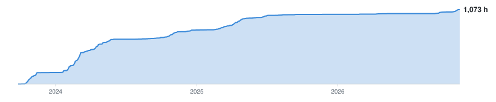
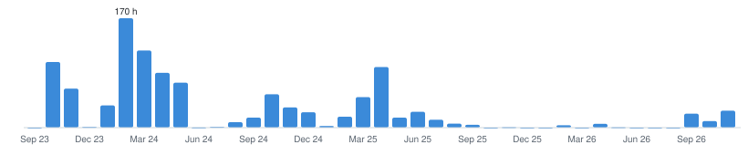
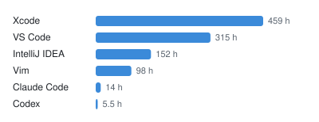
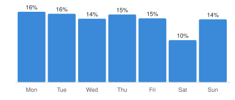

# WakaTime chart options

Candidates for the coding stats section. All are drawn from my WakaTime data; A–D by
`.github/scripts/wakatime_gallery.py` (light and dark), E is a live card.

## A. Total hours over time
<picture><source media="(prefers-color-scheme: dark)" srcset="https://raw.githubusercontent.com/sp4ce-cowboy/sp4ce-cowboy/output/gallery-cumulative-dark.svg"></picture>

## B. Hours per month
<picture><source media="(prefers-color-scheme: dark)" srcset="https://raw.githubusercontent.com/sp4ce-cowboy/sp4ce-cowboy/output/gallery-monthly-dark.svg"></picture>

## C. Hours per editor
<picture><source media="(prefers-color-scheme: dark)" srcset="https://raw.githubusercontent.com/sp4ce-cowboy/sp4ce-cowboy/output/gallery-editors-dark.svg"></picture>

## D. Share of coding time per weekday
<picture><source media="(prefers-color-scheme: dark)" srcset="https://raw.githubusercontent.com/sp4ce-cowboy/sp4ce-cowboy/output/gallery-weekday-dark.svg"></picture>

## E. Languages card (github-stats-extended, live)
<picture><source media="(prefers-color-scheme: dark)" srcset="https://github-stats-extended.vercel.app/api/wakatime?username=space_cowboy&layout=compact&langs_count=8&hide_border=true&theme=github_dark"></picture>

## Links

| Link | What it gives |
|---|---|
| [wakatime.com/@space_cowboy](https://wakatime.com/@space_cowboy) | Public profile: languages, editors and daily totals |
| [wakatime.com/share/embed](https://wakatime.com/share/embed) | WakaTime's own embeddable charts (coding activity, languages, editors, OS), made while logged in; each gives an SVG link for the README |
